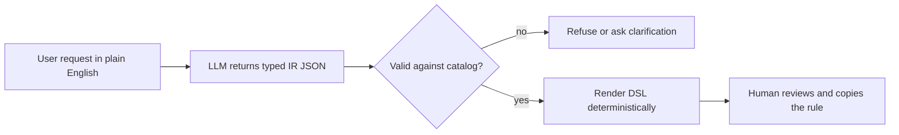

# IUCA Rule Assistant — Simple Architecture

Plain English in → typed IR out of the LLM → validated against the documented catalog → rendered to candidate DSL → human review → copied into the company rule screen. The code never claims real-engine validation.

## Flow

## The 6 steps

1. **Preflight (no LLM):** `python iuca_core.py --out-dir eval_data` — validates the catalog, IR schema, semantic validator, and renderer (15/15 PDF §9 fixtures byte-exact), then generates 54 dev + 17 holdout cases.
2. **Prompt:** `prompts.py` builds the system + few-shot prompt (default variant `v6`) from the same catalog the validator reads.
3. **Ask the model:** `iuca_provider_benchmark.py` (NIM) or `benchmark_llama_server.py` (local/Colab). Adapters do transport only.
4. **Parse and validate:** `parse_json_text` (tolerant JSON) → `AssistantEnvelope` schema → `validate_rule_ir` against the catalog, quoted-string policy, privacy, and history-rule constraints.
5. **Outcome:** `ready` → `render_dsl` produces the candidate DSL; `needs_clarification` → questions to the user; `cannot_express` → reason. Invalid output is counted as a model failure, never silently fixed.
6. **Human review:** the candidate DSL carries the label *"Built from documented patterns — not verified against the IUCA engine"*; a person copies it into the company screen, whose parser is the final check.

## Hard rules

- The LLM never writes DSL text — only the renderer does.
- Unknown catalog items, vague thresholds, mixed `and`/`or`, spaces in quoted values → refuse or clarify, never guess.
- Raw PAN/Aadhaar/identifiers never reach the provider.
- Full details, coverage, and known gaps: `progress.md`; operational rules: `rules.md`.
